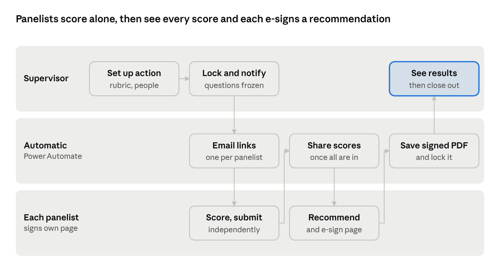

# Interview Panel on SharePoint and Power Apps — Build Plan

Oct 27, 2026 · Cube

## Summary

Move the Interview Selection Process from a single HTML file to SharePoint lists with a Power App on top, so any VA supervisor can run a panel from a link, with no S: drive and no emailed files.

Today the tool works, but about 21 steps go into moving files: each panelist gets an HTML attachment, returns two files by hand, and the supervisor can only import them on the same computer and browser that set the session up. Most supervisors also have no S: drive to keep the work on.

In the new version:

- The supervisor builds the rubric, picks the PBI questions and adds applicants and panelists in one app.
- Each panelist opens a link (in a browser or Teams), scores on their own sheet and submits. Once everyone has, each panelist opens the recommendation page with the whole panel's scores, records a recommendation and e-signs it.
- Scores and recommendations appear for the supervisor as they arrive. Nothing is attached, imported or merged.
- Everything stays inside the VA's own Microsoft 365, with access limited to each hiring action's supervisor and panelists.

It uses only standard Microsoft 365 parts (SharePoint, Power Apps, Power Automate, and the SharePoint and Office 365 connectors), so no premium licence is expected. The 276-question PBI bank comes across as a spreadsheet imported once ([PBI-Question-Bank.xlsx](PBI-Question-Bank.xlsx)).

## Before you build

No outside approvals are needed: you build it yourself, and supervisors keep their own hiring records. Two quick checks before step 1:

- [ ] Power Apps and Power Automate open for you (make.powerapps.com and make.powerautomate.com, signed in with your VA account)
- [ ] You can create a SharePoint site (SharePoint start page → Create site)

Use made-up applicants until the pilot.

## How it works

The supervisor does three things, each panelist two, and the automatic steps carry everything between them.

Once the supervisor locks the questions, each panelist gets a link, scores independently and submits; their scores lock. When the last panelist submits, every panelist opens the recommendation page with the whole panel's scores, records a recommendation and e-signs it. The supervisor sees every score, recommendation and signed PDF without importing anything.

## SharePoint site and lists

One SharePoint site for the whole facility holds eight lists and one document library. Create them in this order, because later lists look up earlier ones. Every list keeps SharePoint's built-in Title, Created and Created By columns.

Site: **Hiring Panels – \<Facility name>** (a communication site or team site that every staff member can open).

**1. Positions** — the jobs you hire for, reused across hiring actions.

| Column | Type | Notes |
| --- | --- | --- |
| Title | Single line | Position name, e.g. Urgent Care RN |
| Service | Choice | Your sections |
| Grade | Single line | e.g. GS-0610-11 |
| Active | Yes/No | Default Yes |

**2. Rubric Criteria** — the supervisor's scoring criteria for each position.

| Column | Type | Notes |
| --- | --- | --- |
| Title | Single line | Criterion, e.g. RN Experience |
| Position | Lookup → Positions | Required |
| PositionID | Number | Copy of the Position ID, set by the app (see delegation note) |
| MaxPoints | Number | 0 decimals |
| Guidance | Multiple lines (plain) | One scoring level per line, e.g. 0 = no experience |
| SortOrder | Number |  |

**3. PBI Questions** — the question bank. Imported once from the spreadsheet that comes with this plan.

| Column | Type | Notes |
| --- | --- | --- |
| Title | Single line | Question code, e.g. Q-001 (comes from the spreadsheet) |
| QuestionText | Multiple lines (plain) | The full question |
| Category | Choice | The 8 categories from the bank. Turn on "Can add values manually" so supervisors can add a new category |
| Source | Choice | PBI Library for the imported 276; Supervisor-added for questions saved from the app (Created By shows who added it) |
| Active | Yes/No | Default Yes; retire questions instead of deleting |

In the list's Advanced settings, set *Create and edit access* to "Create items and edit items that were created by the user". Every supervisor can then add questions and change only their own, while the imported 276 can only be changed by you as site owner. Supervisor-added questions get the next free code (Q-277, Q-278…), set by the app.

**4. Hiring Actions** — one row per vacancy being interviewed.

| Column | Type | Notes |
| --- | --- | --- |
| Title | Single line | Announcement number or a name |
| Position | Lookup → Positions |  |
| PositionID | Number | Set by the app |
| Supervisor | Person |  |
| Panelists | Person (allow multiple) | Any number, not fixed at three |
| CoSupervisors | Person (allow multiple) | Added by the supervisor; full access to the action |
| Viewers | Person (allow multiple) | Added by the supervisor; read-only access to applicants and results |
| PanelApplicants | Multiple lines (plain) | Applicant IDs and names only, copied by Flow 2 at lock, so panelists never need the Applicants list |
| PanelSeesApplicants | Yes/No | Default No. The supervisor turns it on to let this action's panelists read the full Applicants list, including rubric scores and notes |
| Status | Choice | Draft, Questions locked, Panel scoring, Recommendations, Panel complete, Closed |
| InterviewDates | Single line | Free text, e.g. Nov 3–5 |
| LockedOn | Date and time | Set by a flow |
| ClosedOn | Date and time | Set by a flow |

**5. Action Questions** — the fixed, ordered question set for one hiring action.

Add a **QuestionText** column (Multiple lines, plain): the question text copied in when the set is locked, so later edits to the bank never change a running panel.

| Column | Type | Notes |
| --- | --- | --- |
| Title | Single line | Question code, or CUSTOM-1 etc. |
| HiringActionID | Number | Indexed |
| PBIQuestion | Lookup → PBI Questions | Empty for a custom question |
| SortOrder | Number |  |

**6. Applicants** — the people interviewed for one hiring action, with the supervisor's rubric score.

| Column | Type | Notes |
| --- | --- | --- |
| Title | Single line | Applicant name |
| HiringActionID | Number | Indexed |
| InterviewDate | Date and time |  |
| RubricScores | Multiple lines (plain) | JSON of criterion ID → points, written by the app |
| RubricTotal | Number | Written by the app |
| SupervisorNotes | Multiple lines (plain) |  |

**7. Panel Evaluations** — one row per panelist per hiring action, holding all of that panelist's scores and notes. One row instead of one per score keeps the list small, which matters because every row gets its own permissions.

| Column | Type | Notes |
| --- | --- | --- |
| Title | Single line | Set by the app, e.g. panelist name + action |
| HiringActionID | Number | Indexed |
| Panelist | Person | Set to the signed-in user |
| Scores | Multiple lines (plain, unlimited length) | JSON written by the app: applicant → question → score 1–5 and notes |
| ScoresComplete | Yes/No | Set by the app when every applicant has every question scored |
| ScoresSubmittedOn | Date and time | Set when the panelist submits their scores; a flow then locks the row |

For reports and Excel, a flow writes a flat copy of each submitted evaluation (one line per applicant and question) to an Excel file in the site's restricted library (see Automations).

**8. Panel Recommendations** — one row per panelist per hiring action: their recommendation and e-signature on the recommendation page, made after all scores are in. Kept separate from the scores so the scores lock first.

| Column | Type | Notes |
| --- | --- | --- |
| Title | Single line | Set by the app |
| HiringActionID | Number | Indexed |
| Panelist | Person | Set to the signed-in user |
| RecommendedApplicantID | Number | 0 = No selection recommended |
| Rationale | Multiple lines (plain) | Required before signing |
| SignatureName | Single line | Full name the panelist types to sign; the app checks it matches their VA account name |
| SignedOn | Date and time | Set when they sign. With SignatureName and Panelist (their signed-in account), this is the electronic signature. A flow then locks the row |

Also create a document library, **Signed Evaluations**, where Flow 4 saves each panelist's signed PDF. Give it the same permissions as Panel Evaluations: each PDF readable by its panelist and the action's supervisor only.

**Delegation note.** Power Apps can only filter large SharePoint lists reliably on simple columns. That is why each list carries the parent's ID as a plain, indexed Number column (PositionID, HiringActionID) and the app filters on those, not on lookups. Index those columns in List settings → Indexed columns before the lists grow.

## Permissions

The whole facility can open the site, but each hiring action's applicants, scores and signed evaluations are visible only to its supervisor and its panelists. SharePoint's permissions enforce this, not the app, because anyone with access to a list can open it directly in SharePoint.

**The rule: once a supervisor enters an applicant, only that supervisor can see them.** Anyone else gets in only when the supervisor adds them to the hiring action, and only at the level the supervisor chooses. Taking a person off the action takes their access away.

| Who | What they can see and do |
| --- | --- |
| You and one backup owner | Everything; manage lists, flows and the app |
| Everyone in the facility (site members) | Use the app; read Positions and the question bank; add questions to the bank and change their own; start a hiring action |
| A hiring action's supervisor | That action and everything under it: applicants, questions, every panelist's scores and signed evaluation |
| A hiring action's panelists | Applicant names, the questions, and their own score sheet and signed evaluation. Once every panelist has submitted scores, all panelists' scores for that action on the recommendation page. The full Applicants list (rubric scores and notes) only if the supervisor turns that on. Read only after they sign |
| People the supervisor shares the action with | Co-supervisor: everything on that action, can edit. Viewer: that action's applicants and results, read only |

How to set it up:

1. **Site membership.** Add the facility's everyone group (or the all-staff group OIT already maintains) to the site's Members group. Turn off sharing links: Site settings → Sharing → only people in your organization, owners only.
2. **Reference lists are open.** Positions and Rubric Criteria: members can add and edit. PBI Questions: members can add and edit only their own (its Advanced settings, above).
3. **Hiring data is own-items-only.** In Advanced settings of Hiring Actions, Action Questions, Applicants, Panel Evaluations and Panel Recommendations, set *Read access* to "Read items that were created by the user" and *Create and edit access* to "Create items and edit items that were created by the user". A supervisor then sees only the actions they created, and no one else in the facility ever sees them, not even for a moment.
4. **Flows add the people who need in.** Flow 1 gives access only to the people the supervisor adds to the action, at the level chosen, and removes it when they're taken off. When a panelist first opens their score sheet, the app creates their evaluation row, so it is theirs, and Flow 1 grants the supervisor Read on it.
5. **Signed Evaluations library.** Document libraries don't have the own-items setting, so stop inheriting permissions on the library and remove Members from it; Flow 4 grants Read on each PDF to its panelist and the supervisor only.
6. **Locking.** Flow 3 locks a panelist's scores when they submit them; Flow 4 locks their recommendation when they sign.

Two cautions:

- Site owners can see every row. Keep owners to two people.
- If a supervisor leaves, their actions stay invisible to everyone but you. You can reassign one by giving the new supervisor Edit on its rows.

## Power App screens

One canvas app, **Interview Panel**, connected to the eight lists. It decides which screens to show from who is signed in: someone named as Supervisor sees the supervisor screens, someone named as a Panelist sees only their score sheets.

**Supervisor screens**

| Screen | What the supervisor does | Writes to |
| --- | --- | --- |
| My hiring actions | Sees their actions with status and how many panelists have submitted; starts a new action | Hiring Actions |
| Set up action | Picks the position, names the action, adds panelists (any number), enters interview dates, chooses anyone else to share with as co-supervisor or viewer, and decides whether panelists may see the applicant list. Sharing can be changed any time; removing a name removes that person's access | Hiring Actions |
| Rubric | Uses the position's saved rubric, or builds one: criteria, maximum points, scoring guidance per level | Rubric Criteria |
| Applicants | Adds each applicant and interview date; scores them against the rubric | Applicants |
| Questions | Searches the bank by category or word, or writes their own question. Ticking Save to the question bank (and choosing a category) adds it to the bank for every supervisor; left unticked, it is used for this action only. Puts the questions in order | Action Questions; PBI Questions when saved to the bank |
| Question bank | Browses the whole bank; adds new questions with a category; edits or retires questions they added. Retired questions disappear from searches but stay in any action that already used them. | PBI Questions |
| Review and lock | Checks everything, then selects **Lock questions and notify panel**. Questions and applicants can no longer change. | Hiring Actions (Status = Panel scoring) |
| Panel results | Each panelist's progress; once all have submitted, every score side by side by applicant, totals, each recommendation and rationale | Reads Panel Evaluations and Panel Recommendations |
| Close out | Records the panel's final recommendation and closes the action | Hiring Actions (Status = Closed) |

**Panelist screens**

| Screen | What the panelist does | Writes to |
| --- | --- | --- |
| My panels | Sees the actions they are on and what's waiting on them | — |
| Score sheet | One applicant at a time: each question, a 1–5 score and notes, with the supervisor's rubric scores as a read-only reference if the supervisor shared them. Saves as they go; can stop and come back | Panel Evaluations (Scores) |
| Submit scores | Checks for missing scores, then submits. Their scores lock. They can't see anyone else's scores until every panelist has submitted | Panel Evaluations (ScoresSubmittedOn) |
| Recommendation page | Opens once every panelist has submitted: every panelist's scores side by side for each applicant and question, with totals (and rubric totals if shared). The panelist chooses an applicant or "No selection recommended" and writes the job-related rationale | Panel Recommendations |
| Sign | Types their full name under "I reviewed the panel's scores and my recommendation and sign this page electronically" and selects Sign. A flow locks it and saves the signed page as a PDF | Panel Recommendations (SignatureName, SignedOn) |

What carries over from the HTML tool: the rubric builder, the 1–5 scale and its descriptions, the PBI question library, the panelist instructions and acknowledgement wording, and the Panel Recommendations view. What goes: every download, attachment, import and "same computer" rule.

Build for Section 508 from the start: every control gets an accessible label, score buttons are reachable by keyboard, colour is never the only signal, and the app is tested with Narrator before the pilot.

## Automations (Power Automate)

Five flows, all on standard connectors (SharePoint, Office 365 Outlook, Excel Online). Each runs under your account; add a co-owner to every flow so they don't stop if you move on.

| Flow | Runs when | What it does |
| --- | --- | --- |
| 1. Set access | A Hiring Action is created or its Panelists, CoSupervisors, Viewers or PanelSeesApplicants change, or a Panel Evaluation or Panel Recommendation is created | Gives access only to the people on the action: co-supervisors Edit and viewers Read on the action, its questions and applicants; panelists Read on the action and its questions, plus its applicants when the supervisor has turned on PanelSeesApplicants (and removes it if turned off). Removes access from anyone taken off. Grants the supervisor and co-supervisors Read on each new Panel Evaluation and Panel Recommendation |
| 2. Notify panel | Status changes to Panel scoring | Copies question text into Action Questions and applicant names into PanelApplicants, sets LockedOn, makes questions and applicants read-only for everyone, and emails each panelist a link to their score sheet |
| 3. Scores in | A Panel Evaluation's ScoresSubmittedOn is set | Makes that evaluation read-only for the panelist, writes the flat copy of their scores to the action's Excel file, and emails the supervisor "2 of 3 score sheets in". When the last panelist submits: sets Status to Recommendations, gives every panelist on the action Read on all panelists' evaluations, and emails them that the recommendation page is open |
| 4. Signed recommendation | A Panel Recommendation's SignedOn is set | Makes the recommendation read-only; saves a PDF of the recommendation page (all panel scores plus this panelist's recommendation and rationale) stamped "Electronically signed by \<name> (\<VA email>) on \<date and time>" to Signed Evaluations (OneDrive for Business Convert file action). When the last panelist signs: sets Status to Panel complete and emails the supervisor and co-supervisors |
| 5. Reminders | Every weekday morning | Emails panelists whose score sheet or recommendation is still open 2 working days after the action was locked (supervisor can turn this off per action) |

Emails contain links and counts only, never applicant names or scores, so nothing personal sits in inboxes.

## Build order

Each stage ends with a check. Don't start the next stage until it passes.

1. **Site.** Create the site Hiring Panels – \<Facility>, add a second owner, add the facility's all-staff group as Members, and turn off sharing links.
   - Check: a colleague can open the site.
2. **Lists.** Create the eight lists and the library in the order in SharePoint site and lists, with every column and choice exactly as listed. Index HiringActionID and PositionID.
   - Check: List settings shows every column, with no typos in internal names. Renaming later doesn't change internal names.
3. **Question bank.** Import the spreadsheet: in the PBI Questions list, use Edit in grid view and paste the rows, or create the list straight from the spreadsheet's table.
   - Check: 276 questions, 8 categories.
4. **Privacy settings.** Set the own-items Advanced settings on Hiring Actions, Action Questions, Applicants, Panel Evaluations and Panel Recommendations, and lock down the Signed Evaluations library (see Permissions).
   - Check: with two test accounts, each sees only the rows they created, in the app and directly in SharePoint.
5. **Flow 1, Set access.** Build and test before any app screen.
   - Check: a test action is visible to its supervisor and panelists and invisible to another supervisor.
6. **Supervisor screens**, in screen order, with made-up data.
   - Check: a test supervisor can set up an action end to end without help.
7. **Flow 2, Notify panel.**
   - Check: locking sends the emails, and questions can't be edited afterwards, even directly in SharePoint.
8. **Panelist screens.**
   - Check: a test panelist scores three applicants on a phone and a laptop, stops halfway, comes back, and finds their scores.
9. **Flows 3 to 5.**
   - Check: submitting scores locks them; nobody sees others' scores until the last panelist submits, then everyone does; signing locks the recommendation and saves the PDF; the action moves to Panel complete after the last signature.
10. **Results and close-out screens.**
    - Check: the side-by-side results match the Excel copy.
11. **Accessibility pass.** Run the Power Apps accessibility checker and a Narrator walk-through of both roles; fix every issue.
12. **Share the app** with the service's supervisors and pin it in a Teams channel.

## Pilot, rollout and retiring the HTML tool

Run one real hiring action in the new app before offering it to anyone else, and keep the HTML tool as a fallback until then.

1. **Dry run.** You as supervisor and three colleagues as panelists, made-up applicants. Time it against the HTML tool and note every question people ask.
2. **Pilot.** One real hiring action with a supervisor who volunteers. Keep the HTML tool ready in case anything blocks the panel.
3. **Fix and write the one-page guide.** Replace the 4-page HTML guide with one page per role, using screenshots from the app.
4. **Roll out to your service.** Share the app with its supervisors, run a 20-minute demo, and point the Instructions tab of the HTML tool to the new app.
5. **Other services.** Everyone uses the same site. Share the app with each service's supervisors as they're ready and give them the one-page guide.
6. **Retire the HTML tool** once two hiring actions have run cleanly: move it into the repo's archive folder and remove it from the S: drive.
7. **Every year.** Supervisors export and keep their closed actions, then delete them so the lists stay fast.

## Open questions and decisions

- [x] **Signing.** Decided: panelists sign electronically in the app when they submit; no hand signatures.
- [x] **One site per service, or one for the facility?** Decided: one site for the whole facility; the own-items settings keep each supervisor's actions private.
- [x] **Who owns it long term?** Decided: you'll name a second owner who can maintain the app and flows if you move on. Add them as site owner and co-owner of the app and every flow before the pilot.
- [x] **Can panelists see the rubric scores?** Decided: the supervisor chooses for each action. By default panelists see applicant names only; turning on PanelSeesApplicants shares the full list.
- [x] **Reminder timing.** Decided: a reminder 2 working days after questions are locked, which the supervisor can turn off per action.
- [x] **Question bank changes.** Decided: any supervisor can write their own questions and save them to the shared bank; they can edit or retire the ones they added, and you as site owner can change any.
